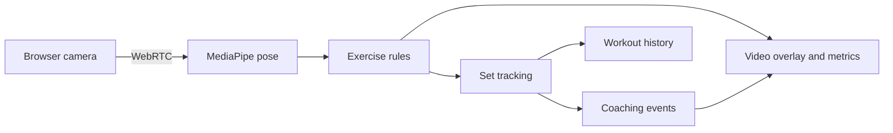

# Real-Time AI Gym Coach

A webcam workout tracker that estimates body landmarks, counts reps, shows form cues, and saves completed sets. The five modes are squats, push-ups, dumbbell curls, shoulder presses, and lunges. Optional speech uses Groq and gTTS.

## Run locally

Use Python 3.11. On an Apple Silicon Mac with Conda, run these commands from the project root. If `venv/` already contains a working Python 3.11 environment, skip the environment creation command.

```bash
conda create --yes --prefix "$PWD/venv" python=3.11 pip
./venv/bin/python -m pip install -r "gym_app/requirements.txt"
./venv/bin/python -m streamlit run "gym_app/main.py"
```

Open [localhost:8501](http://localhost:8501). Choose an exercise, and click **Start Workout**. Start the video component and grant camera access. Keep the relevant joints visible. Try one set of three squats, then check the completed set in **Workout History**.

Text cues work without credentials. To enable optional voice, provide `GROQ_API_KEY` as an environment variable or a Streamlit secret before launching. Then turn on **AI voice coaching** in the sidebar before starting a workout. Voice requests require internet access. The default Groq model is `openai/gpt-oss-120b`. Set `GROQ_MODEL` to select another model available to your account. If Groq fails, the app tries to speak its built-in cue. Keep the key private and out of Git.

## Architecture



MediaPipe processes video in the Python app. The detectors measure joint angles from landmark coordinates, use stages to count reps, and emit heuristic form cues. Set tracking caps reps at the goal and commits completed sets before requesting optional coaching. In a hosted version, webcam frames travel to the Python server. If enabled, Groq receives event and issue text and gTTS receives the generated cue.

## Run regression tests

```bash
PYTHONPATH="gym_app" ./venv/bin/python -m unittest discover -s "gym_app/tests" -v
```

The tests cover synthetic rep cycles for each detector, completion limits, reconnects, pose loss, and voice failures. They use no camera, API key, or live workout database.

## Demo scope

The default guest mode needs no account. Completed sets are private to the current app session and disappear on reload or disconnect. To use your existing SQLite history on a trusted local machine, launch with `GYM_COACH_MODE=local`. The local username screen is a profile selector and should only be used on a trusted machine. Form cues are camera-dependent estimates and have not been benchmarked on labeled workout footage. Voice calls have timeouts and text fallbacks and still run synchronously. The separate `LandingPage/` is a legacy page with placeholder media and external links. Verify its attribution and asset permissions before publishing it.


## Deploy the guest demo

Deploy the GitHub repository in Streamlit Community Cloud using branch `main`, entrypoint `gym_app/main.py`, and Python 3.11. Leave `GYM_COACH_MODE` unset so the deployed app uses guest sessions. The first deployment can use text coaching without secrets. If you enable voice, enter `GROQ_API_KEY` in the host’s app secrets.

Test the link with two separate browser sessions. Complete one set in the first and confirm that the second starts with empty history. Verify that the remote webcam can connect from another network. Restrictive networks may require a TURN relay.
